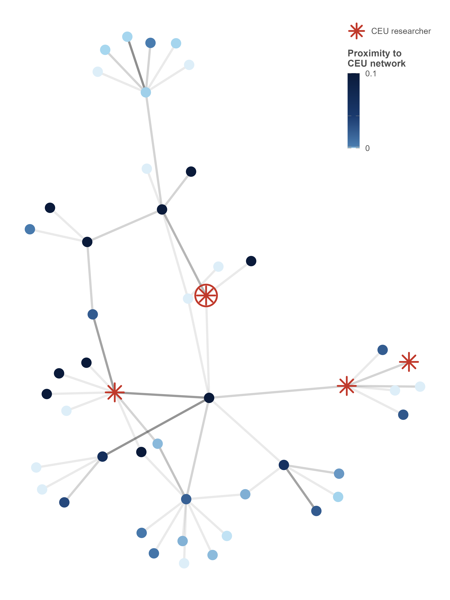

  

    
    

      Paris School of Economics 
      Collège de France 
      EHESS
    

    

      <a href="mailto:luc.paluskiewicz@psemail.eu">luc.paluskiewicz[at]psemail.eu</a> 
    

    

      <a href="https://scholar.google.com/citations?user=194d6voAAAAJ&hl=fr&oi=ao" title="Google Scholar" aria-label="Google Scholar" target="_blank" rel="noopener">
        <svg viewBox="0 0 24 24" role="img"><path d="M12 3 1 9l11 6 9-4.91V17h2V9L12 3zM5 13.18v4L12 21l7-3.82v-4L12 17l-7-3.82z"/></svg>
      </a>
      <a href="https://lucpaluskiewicz.github.io/Luc_PALUSKIEWICZ_CV_En.pdf" title="Curriculum Vitae" aria-label="Curriculum Vitae" target="_blank" rel="noopener">
        <svg viewBox="0 0 24 24" role="img"><path d="M14 2H6a2 2 0 0 0-2 2v16a2 2 0 0 0 2 2h12a2 2 0 0 0 2-2V8l-6-6zm2 16H8v-2h8v2zm0-4H8v-2h8v2zm-3-5V3.5L18.5 9H13z"/></svg>
      </a>
    

  

  

I am a PhD candidate in Economics at [Paris School of Economics (PSE)](https://www.parisschoolofeconomics.eu/) and [Collège de France](https://www.college-de-france.fr/fr). I am supervised by [Philippe Aghion](https://www.philippeaghion.com/) and affiliated with the [Farhi Innovation Lab](https://www.farhi-innovation-lab.fr/).

**I am on the 2026-2027 economics academic job market.**

My research interests lie in the Economics of Science and Innovation and in Political Economy. My main focus is on how political institutions shape innovation, especially how political pressures affect academics' production of ideas.

In 2025, I was a visiting scholar at the Department of Applied Economics of the Universitat Autonoma de Barcelona (hosted by [Riccardo Turati](https://sites.google.com/view/riccardoturati)), and the University of Munich LMU (hosted by [Fabian Waldinger](https://www.fabianwaldinger.com/)). During the Spring term 2026 I visited the University of Warwick (hosted by [Sascha O. Becker](https://www.sobecker.de/)).

Since 2023, I co-organize the [Brown Bag Economics of Innovation Seminar](https://www.parisschoolofeconomics.eu/evenements/brown-bag-economics-of-innovation-seminar/), which is a joint seminar between the Collège de France and INSEAD. Feel free to contact me if you would like to present.

  

<h2 id="job-market-paper">Job Market Paper</h2>

<a class="jmp-title" href="https://lucpaluskiewicz.github.io/publications/LucPaluskiewicz_JMP.pdf" target="_blank" rel="noopener">How to Silence Researchers? Evidence from Illiberal Policies in Hungary</a>

 with <a href="https://raphaelwargon.github.io/" style="color: #555; text-decoration: none;">Raphaël Wargon</a>
<a href="https://lucpaluskiewicz.github.io/publications/LucPaluskiewicz_JMP.pdf" target="_blank" rel="noopener" style="color:#c43e54; font-size: 0.9rem; text-decoration: none;">[Last version]</a>

<u><strong>Abstract</strong></u>

Does political pressure on academics reduce the production of ideas? We study this question in Hungary after the election of Viktor Orbán in 2010, which started a lasting decline in academic freedom. Combining rich national research repositories and international bibliometric data, we compare, in a difference-in-differences design, researchers likely to be perceived as political opponents, based on their pre-2010 institutional affiliations and research topics, with neutral researchers. After 2010, perceived opponents publish 18% fewer papers and far fewer papers in top journals. We explain this loss by a decline in their number of co-authors, not by funding. These academics respond strongly by leaving the country, by expressing dissent against the government, mainly in English, or by self-censoring in their Hungarian-language work. Individual-level cross-country comparisons with Slovenia and Croatia show that all Hungarian researchers, not only perceived political opponents, shift their publications toward lower-ranked national-language journals and are more likely to leave the country.

<u>Presentations:</u> Innovation Seminar (LMU), Brown Bag Seminar in Innovation Economics (Collège de France and INSEAD), Applied Young Economists Webinar (AYEW), Political Economy & Public Economics Reading Group (University of Warwick), 2026 EAYE Annual Meeting, 2nd EUI ECO PhD Workshop (co-author), BSE Summer Forum Economics of Science and Innovation, CERGIC Internal Seminar, 8th International Conference on European Economics and Politics, NBER Summer Institute 2026 Science of Science Funding <a class="video-badge" href="https://youtu.be/8q3WXSysa-4?t=26204" target="_blank" rel="noopener">&#9654; Watch the video</a>, EEA 2026 Annual Meeting, Micro and Macro Perspective of the Labor Market Virtual Workshop (Duke University), 11th ZEW Conference on the Economics of Innovation and Patenting, Internal Seminar LED (Paris 8), Internal Seminar (Collège de France).

