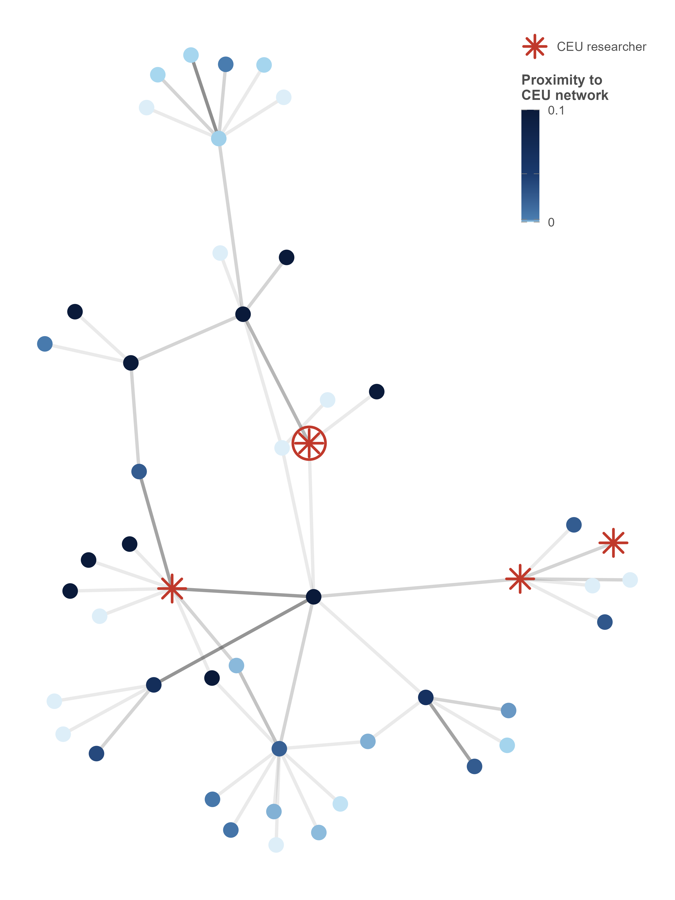

<h2 id="job-market-paper">Job Market Paper</h2>

<a class="paper-title" href="https://lucpaluskiewicz.github.io/publications/LucPaluskiewicz_JMP.pdf" target="_blank" rel="noopener">How to Silence Researchers? Evidence from Illiberal Policies in Hungary</a>

with <a href="https://raphaelwargon.github.io/" style="color: #555;">Raphaël Wargon</a>
<a href="https://lucpaluskiewicz.github.io/publications/LucPaluskiewicz_JMP.pdf" target="_blank" rel="noopener" style="color:#c43e54; font-size: 0.9rem; text-decoration: none;">[Draft]</a>

<u><strong>Abstract</strong></u>

Does political pressure on academics reduce the production of ideas? We study this question in Hungary after the election of Viktor Orbán in 2010, which started a lasting decline in academic freedom. Combining rich national research repositories and international bibliometric data, we compare, in a difference-in-differences design, researchers likely to be perceived as political opponents, based on their pre-2010 institutional affiliations and research topics, with neutral researchers. After 2010, perceived opponents publish 18% fewer papers and far fewer papers in top journals. We explain this loss by a decline in their number of co-authors, not by funding. These academics respond strongly by leaving the country, by expressing dissent against the government, mainly in English, or by self-censoring in their Hungarian-language work. Individual-level cross-country comparisons with Slovenia and Croatia show that all Hungarian researchers, not only perceived political opponents, shift their publications toward lower-ranked national-language journals and are more likely to leave the country.

<u>Presentations:</u> Innovation Seminar (LMU), Brown Bag Seminar in Innovation Economics (Collège de France and INSEAD), Applied Young Economists Webinar (AYEW), Political Economy & Public Economics Reading Group (University of Warwick), 2026 EAYE Annual Meeting, 2nd EUI ECO PhD Workshop (co-author), BSE Summer Forum Economics of Science and Innovation, CERGIC Internal Seminar, 8th International Conference on European Economics and Politics, NBER Summer Institute 2026 Science of Science Funding <a class="video-badge" href="https://youtu.be/8q3WXSysa-4?t=26204" target="_blank" rel="noopener">[&#127909; NBER recorded talk]</a>, EEA 2026 Annual Meeting, Micro and Macro Perspective of the Labor Market Virtual Workshop (Duke University), 11th ZEW Conference on the Economics of Innovation and Patenting, Internal Seminar LED (Paris 8), Internal Seminar (Collège de France).

---
## Publications

<a class="paper-title" href="https://onlinelibrary.wiley.com/doi/10.1111/iere.70107" target="_blank" rel="noopener">Scientific Isolation? The Consequences of Trump's China Initiative on Chinese Research</a>, <em>International Economic Review</em>

with <a href="https://www.philippeaghion.com/">Philippe Aghion</a>, Céline Antonin, <a href="https://davidstro.github.io/">David Strömberg</a>, <a href="https://xuepingsun.github.io/">Xueping Sun</a>, <a href="https://raphaelwargon.github.io/">Raphaël Wargon</a> and Karolina Westin <a class="paper-link" href="https://onlinelibrary.wiley.com/doi/10.1111/iere.70107" target="_blank" rel="noopener">Link</a>

Abstract

The 2018 China Initiative by the Trump administration complicated procedures and reduced funding for US-China research collaborations. Using Scopus data, we analyze its impact on Chinese research. We find that the China Initiative significantly lowered the average quality of both the publications and the co-authors of Chinese researchers with prior US collaborations compared to Chinese researchers with prior European collaborations. We estimate that the China Initiative reduced yearly citations for affected Chinese researchers by 6 percent. The effect was stronger for high-productivity Chinese researchers in US-dominated fields, especially when their US co-authors played a leading role.

---
## Working Papers

The Life Cycle of Ideas

with <a href="https://www.philippeaghion.com/">Philippe Aghion</a>, <a href="https://sites.google.com/site/abergeaudeco">Antonin Bergeaud</a>, <a href="http://www.gder.info/">Gaétan de Rassenfosse</a> and <a href="https://raphaelwargon.github.io/">Raphaël Wargon</a>

Abstract

We contribute to the debate on the production of ideas by examining the scientific production of an entire field. We map the evolution of economic research by classifying 300,000 articles published in 1950–2020 using text analysis methods. We identify 90 distinct topics each characterized by a coherent set of themes and vocabulary. We document three main empirical patterns: topics show a rise-and-fall life cycle, aggregate scientific activity grows over time, and this growth is accompanied by a constant reset in the topic composition of the discipline, with newer topics progressively displacing older ones.

Presentations

Past: Brown Bag Seminar in Innovation Economics (Collège de France and INSEAD), <strong>11th Monash-Paris-Warwick-Zurich-CEPR Text-As-Data Workshop</strong>, NBER SI 2026 Science of Science Funding.

<a class="paper-title" href="https://papers.ssrn.com/sol3/papers.cfm?abstract_id=6674478" target="_blank" rel="noopener">The Political Legacy of Displacement: Evidence from the Spanish Republican Exile</a>

with <a href="https://cristinaaranzana.github.io/">Cristina Aranzana</a> <a class="paper-link" href="https://papers.ssrn.com/sol3/papers.cfm?abstract_id=6674478" target="_blank" rel="noopener">[Working Paper]</a>

Abstract

This paper studies the long-run political consequences of forced displacement when refugees carry distinct political ideas. With the collapse of the Spanish Republic in 1939, 500,000 left-wing leaning refugees fled into France, where logistical constraints quasi-randomly determined refugee camp locations. Exploiting this setting, we identify the causal effect of refugee exposure on political behaviour. Exposed municipalities shift away from Socialist support toward the Communist Party and display greater resistance activity and left-wing associational life.

Presentations

Past: 8th Economics and Politics Workshop, <strong>Congrès de l'Association Française d'Histoire Economique</strong>, UB PhD Seminar, Barcelona Applied PhD Seminar, IEB Internal Work-in-Progress Seminar.
<!--
Upcoming: 
-->

---

## Work in Progress

The Downside of Gender Electoral Policies: Strategic Party Behaviour in Brazil

with <a href="https://mariajosegonzalezfuentes.github.io/">María José González-Fuentes</a>

Abstract

Can party behaviour explain why gender equality policies fail to increase women's political representation? Using data from seven municipal elections, we show that Brazilian political parties undermine gender quotas and funding requirements by strategically placing female candidates in races where they expect weak performance while reserving "sure" races for men. Despite national-level compliance requirements, weak enforcement at the municipal level enables this strategic distribution across localities based on electoral competitiveness.

Presentations

Past: 3rd ENS de Lyon – University of Bologna PhD Workshop, 8th Economics and Politics Workshop, CERGIC Internal Seminar, <strong>Gender Gaps Conference 2024, PSE-GPET Internal Seminar</strong>.
<!--
Upcoming: 
-->

The Price of Property Right: Innovation in Soviet Union and Russia

with <a href="https://fedorboboshin.github.io/">Fedor Boboshin</a> and <a href="https://sites.google.com/view/econjaecho/home">Jae Cho</a>

